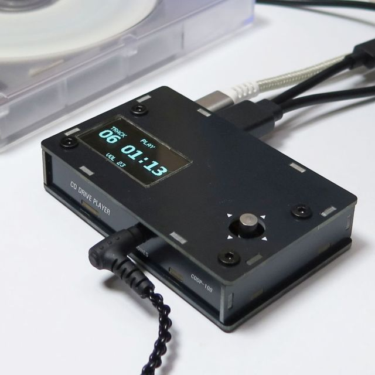

# CD Drive Player: CDDP-100

Support information for the CD Drive Player (CDDP-100), a player that turns a USB CD/DVD drive into an audio CD player.

## About the player

CD Drive Player turns a USB CD/DVD drive into a standalone audio CD player.
Connect the drive, insert an audio CD, and listen through headphones, an amplifier or a digital audio device. No PC is needed.

The player works as a USB host and reads the audio data from the disc digitally.
Use it with the bundled drive or one of the [supported drives](#supported-drives).

The player is available on [Etsy](https://elehobica.etsy.com/listing/4607409462).

### Key features

- Plays audio CDs with a USB CD/DVD drive, without a PC
- Headphone and line outputs with volume control, or a fixed line output
- Optical digital output (S/PDIF, TOSLINK) to feed an external DAC or an AV receiver
- Five play modes: Sequential, Shuffle, Sequential Repeat, Shuffle Repeat and Single Repeat
- No gap between consecutive tracks
- Resume from the stop position
- OLED display and a 5-way switch
- Powered from USB Type-C, supplies USB bus power to the drive

### Specifications

| Item | Specification |
|------|---------------|
| Model | CDDP-100 |
| Media | Audio CD (CD-DA) |
| Drive interface | USB-A port for a USB CD/DVD drive |
| Headphone output | 3.5 mm stereo, volume controlled |
| Line output | 3.5 mm stereo, volume controlled or fixed level |
| Digital output | S/PDIF optical (TOSLINK), 16-bit / 44.1 kHz |
| Display | 128 x 64 dot OLED |
| Controls | 5-way switch (up, down, left, right, center push) |
| Power | USB Type-C, 5 V / 3 A or more (USB PD power adapter rated 20 W or more required) |
| Dimensions | 83.0 mm (W) x 21.0 mm (H) x 53.0 mm (D), including the 5-way switch button |
| Weight | 78 g (player only) |

### Notes

- Only audio CDs (CD-DA) are played. Data tracks, MP3 / WAV files on a data disc, DVDs and CD-Text are not supported.
- This is a player only. It does not record, rip or write discs.
- Operation is guaranteed only with the [supported drives](#supported-drives).
- Connect only one CD/DVD drive to the USB-A port, without a USB hub.
- A drive needs a large current while the disc spins up. If your drive has its own power input (such as the auxiliary plug of a Y cable or the power adapter of a drive enclosure), connect that power first.

### User Guide

- [CD Drive Player User Guide](docs/CD_Drive_Player_User_Guide_rev1.3.pdf)

## Supported drives

Operation is guaranteed with the bundled drive and with the drives below (brand / model number).

- ASUS / SDRW-08U7M-U
- ASUS / SDRW-08U8M-U (USB-C (female) to USB-A (male) adapter Required)
- ASUS / SDRW-08U9M-U
- Dell / DW316
- HP / F2B56AA
- HP / GP70N
- LG (Hitachi-LG Data Storage) / GP62NB60, GP62NW60
- LG (Hitachi-LG Data Storage) / GP65NB60, GP65NW60

The guarantee applies with the firmware installed at shipping, when the player is used with a USB PD power adapter rated 20 W or more,
the drive is connected directly to the player without a USB hub, and the drive itself works normally (for example, it reads CDs on a PC).

The bundled drive is the drive offered together with the player. Its manufacturer and model number may change without notice,
but only drive models that have been tested with the player are shipped.
It is a general USB drive for PCs, but its operation is guaranteed only in combination with the player.

You are free to use the player with other USB CD/DVD drives, but their operation is not guaranteed.
See the [drive reports](#drive-reports) for how other drives work.

## Drive reports

Apart from the supported drives, other USB CD/DVD drives may also work with the player,
such as a drive you already have, or a desktop drive with a USB-SATA adapter.
To help you enjoy the player with various drives, users and we share how each drive works with the player,
including drives that do not work. Your reports make this information more useful for everyone.

- [Drive report list](drives/README.md): how various USB CD/DVD drives work with the player, including drives that do not work
- [Report your drive](https://docs.google.com/forms/d/e/1FAIpQLSfNHyWI4UzrhYMMLvaGWSQck-JyMFxhJAjfBhDYurqOIGMEGg/viewform): tell us how your drive works with the player (a Google account is needed)

This information is for reference.
A drive listed there as working is not covered by the guarantee unless it is one of the [supported drives](#supported-drives).

Before reporting, open CONFIG > ABOUT on the player with the drive connected (see the [user guide](docs/CD_Drive_Player_User_Guide_rev1.3.pdf)).
The form asks for the four lines on that screen (FW, USB, VND, PRD) and a photo of it.

Reports are reviewed before they are published.

## License

- Drive reports and their photos are published under the [CC BY 4.0](https://creativecommons.org/licenses/by/4.0/) license.
- Product photos: all rights reserved.

---

This page is also published at [elehobica.github.io/cd_drive_player_support](https://elehobica.github.io/cd_drive_player_support/).
