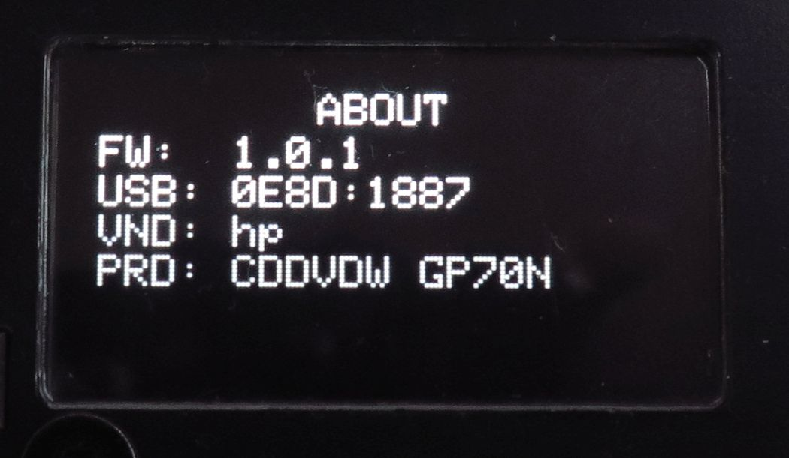
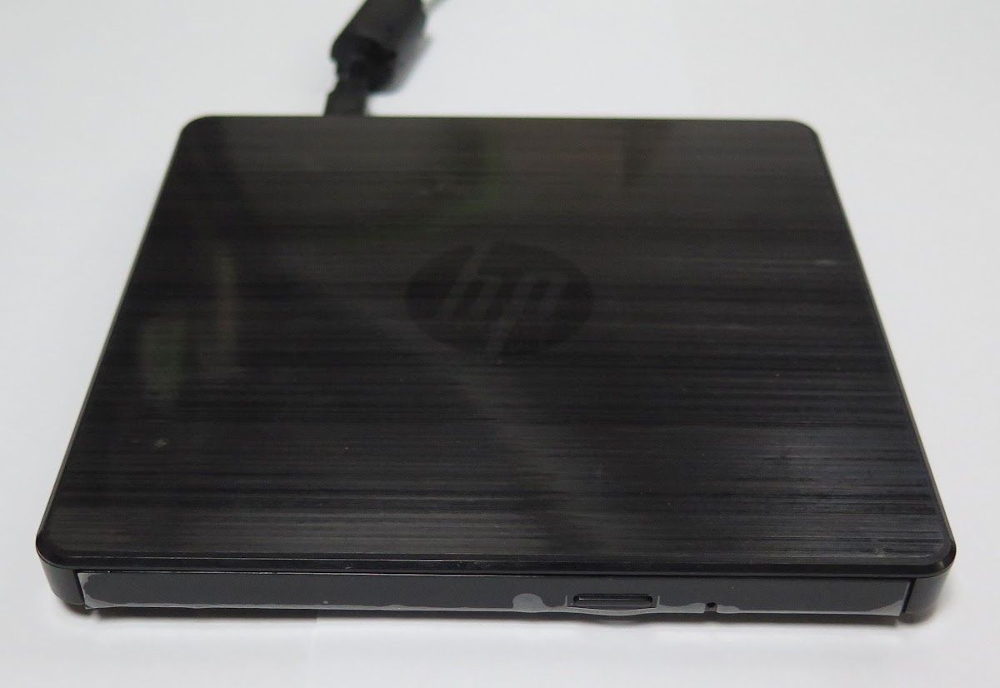
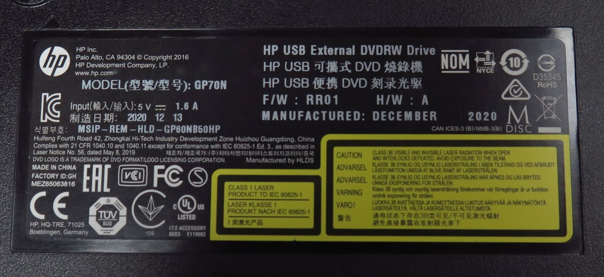

<!-- generated, do not edit -->
# hp CDDVDW  GP70N (r0001)

| Item | Value |
|---|---|
| Vendor (VND) | hp |
| Product (PRD) | CDDVDW  GP70N |
| USB ID | 0E8D:1887 |
| Name on the drive | HP USB External DVDRW Drive |
| Drive type | Slim external USB drive (ready-made or in an enclosure) |
| Power to the drive | From the player only (CD DRIVE USB) |
| Power adapter of the player | PD 20 W |
| Condition | Used by myself |
| Result | ✅ Works |
| Symptoms | None |
| Discs tried | Pressed audio CD |
| CONFIG > DRIVE > READ SPEED | 8x |
| CONFIG > DRIVE > WARMUP SECTORS | 300 |
| CONFIG > DRIVE > OVERLAP READ | Off |
| Firmware (FW) | 1.0.1 |
| Reported by | Elehobica |
| Date | 2026-11-08 |

## Photos

[Back to the drive report list](../../README.md)
