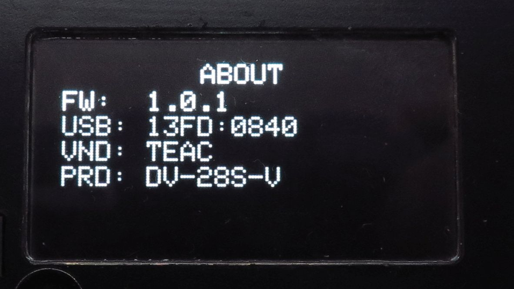
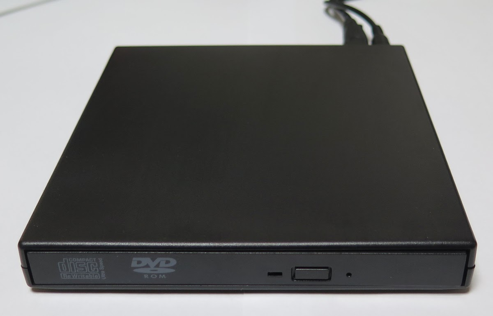
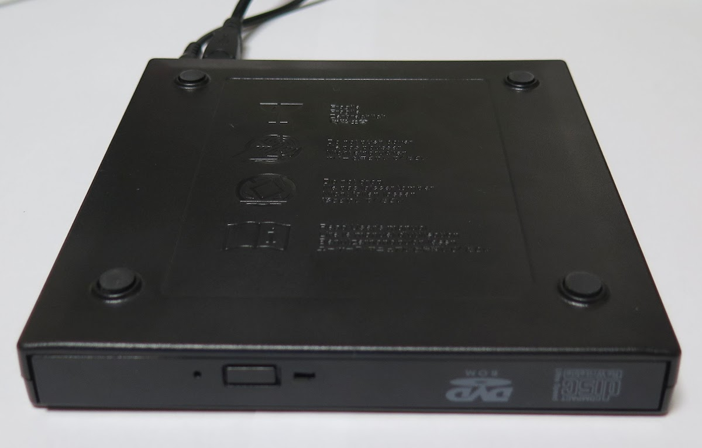
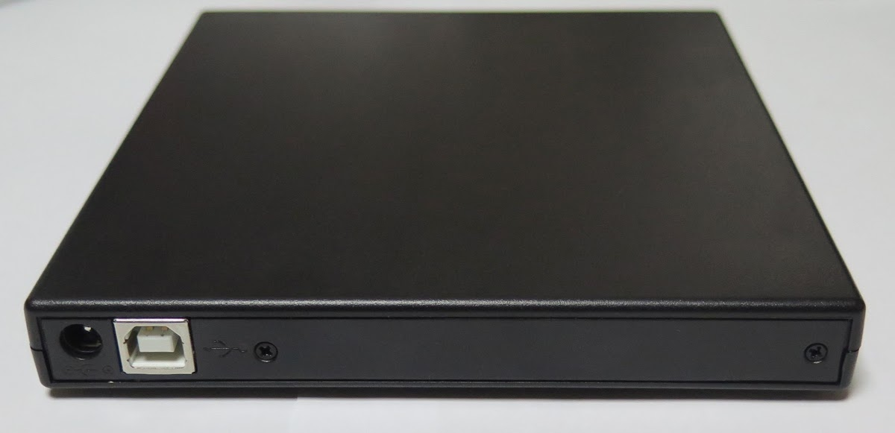

<!-- generated, do not edit -->
# OEM / USB Slim Portable Optical Drive: TEAC DV-28S-V (r0005)

| Item | Value |
|---|---|
| Brand | OEM |
| Name on the drive | USB Slim Portable Optical Drive |
| Vendor (VND) | TEAC |
| Product (PRD) | DV-28S-V |
| USB ID | 13FD:0840 |
| Drive type | Slim external USB drive (ready-made or in an enclosure) |
| Power to the drive | Extra 5 V to the drive (Y cable or auxiliary input) |
| Power adapter of the player | USB PD 20 W + QC 18W (USB-A) |
| Condition | New |
| Result | 🟠 Partially |
| Symptoms | Other |
| Discs tried | Pressed audio CD |
| CONFIG > DRIVE > READ SPEED | 8x |
| CONFIG > DRIVE > WARMUP SECTORS | 300 |
| CONFIG > DRIVE > OVERLAP READ | Off |
| Firmware (FW) | 1.0.1 |
| Reported by | Elehobica |
| Date | 2026-11-08 |

## Comment

A faint crackling sound, reminiscent of the surface noise from a vinyl record, occurs roughly once every few tens of seconds.

## Photos

[Back to the drive report list](../../README.md)
