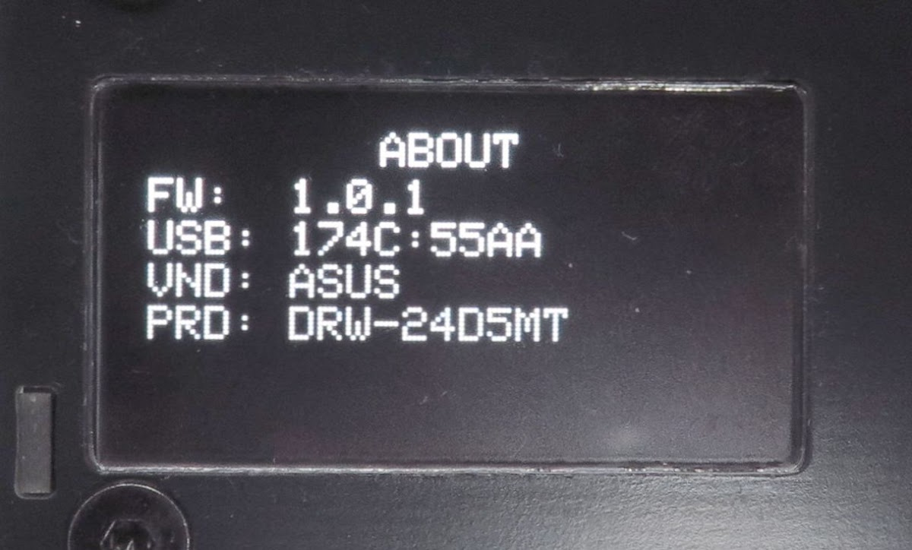
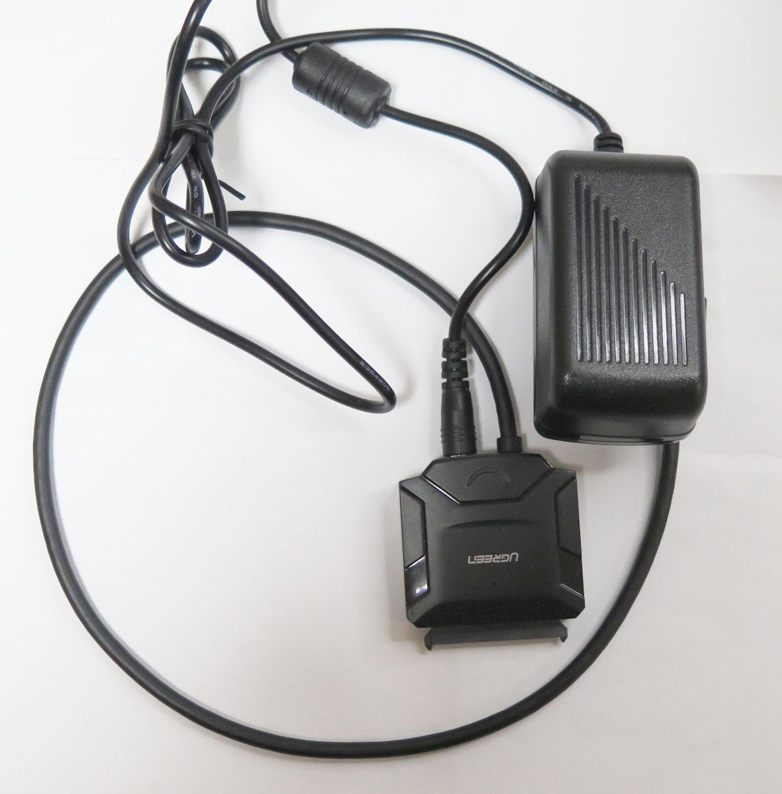
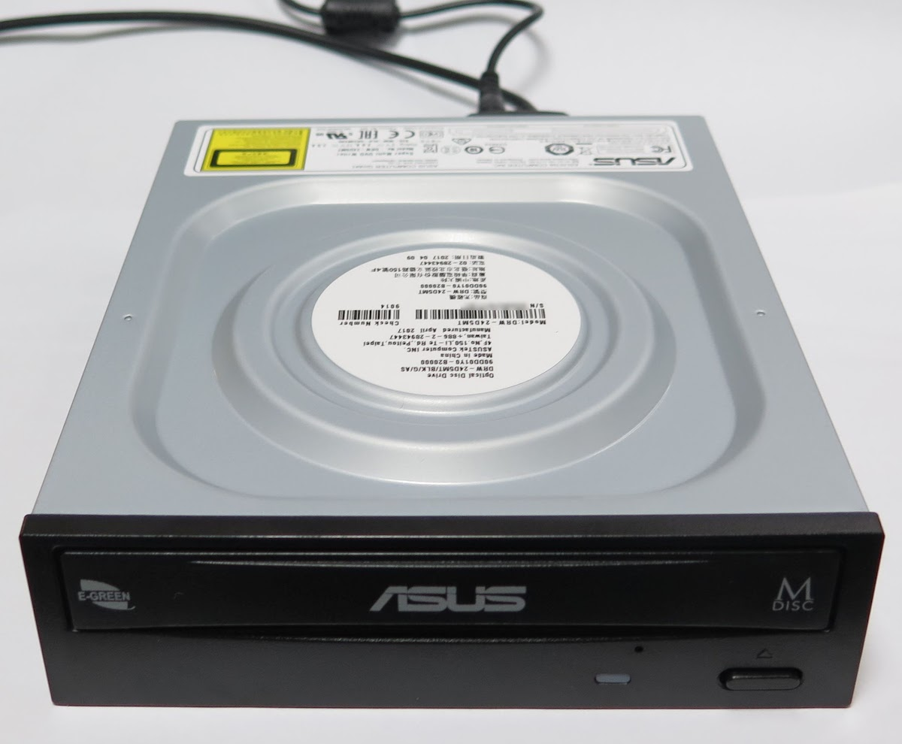
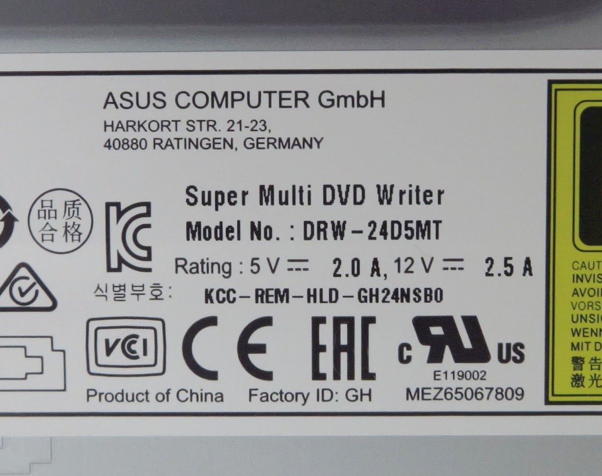

<!-- generated, do not edit -->
# ASUS / Super Multi DVD Writer: ASUS DRW-24D5MT (r0007)

| Item | Value |
|---|---|
| Brand | ASUS |
| Name on the drive | Super Multi DVD Writer |
| Vendor (VND) | ASUS |
| Product (PRD) | DRW-24D5MT |
| USB ID | 174C:55AA |
| Drive type | Desktop 5.25" drive with a USB-SATA adapter cable |
| Power to the drive | 12 V supply (desktop drive) |
| Power adapter of the player | USB PD 20W + 12V |
| Condition | Used by myself |
| Result | 🟠 Partially |
| Symptoms | The sound drops a few seconds after the start |
| Discs tried | Pressed audio CD |
| CONFIG > DRIVE > READ SPEED | 8x |
| CONFIG > DRIVE > WARMUP SECTORS | 300 |
| CONFIG > DRIVE > OVERLAP READ | Off |
| Firmware (FW) | 1.0.1 |
| Reported by | Elehobica |
| Date | 2026-11-08 |

## Comment

The sound drops happen only for the first time from power-up of the drive. It works well after that. The atapter is UGREEN USB 3.0 to SATA III Hard Drive Adapter Model 20231.

## Photos

[Back to the drive report list](../../README.md)
