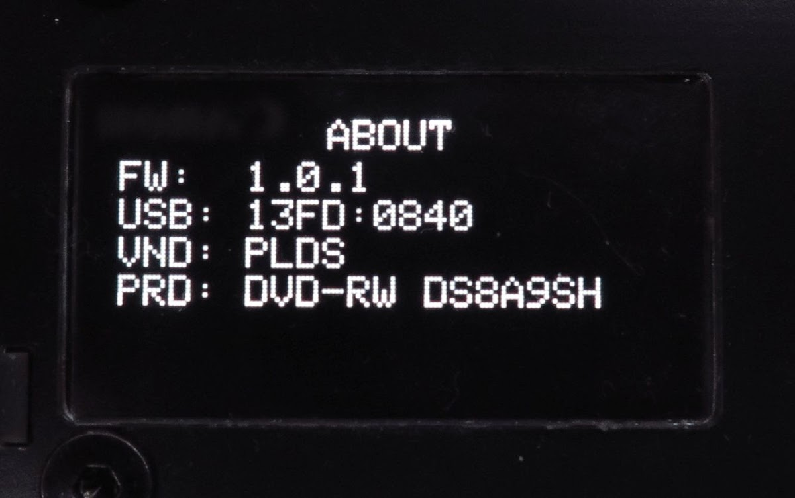
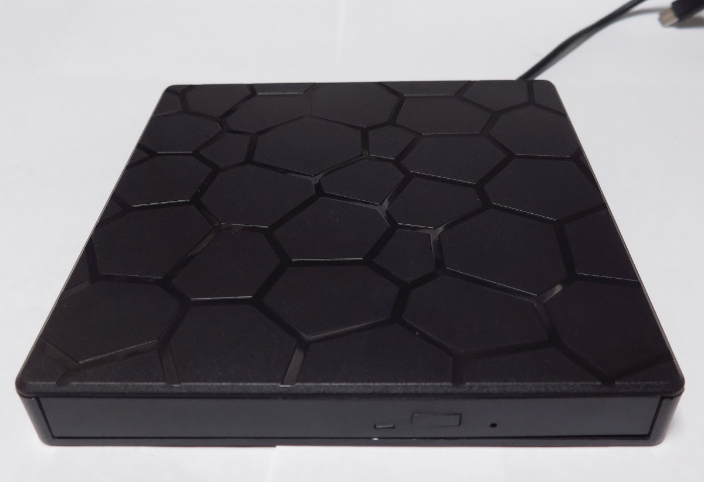
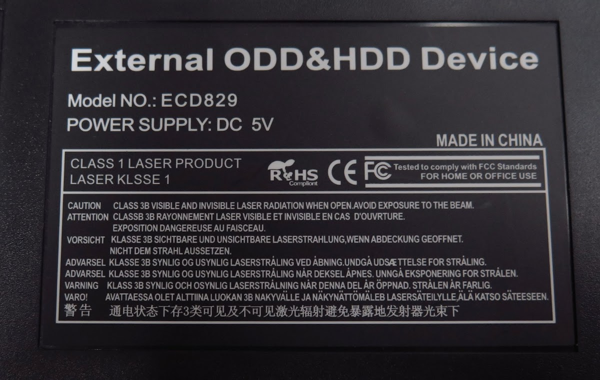

<!-- generated, do not edit -->
# OEM / External ODD&HDD Device (Model NO.: ECD829): PLDS DVD-RW DS8A9SH (r0009)

| Item | Value |
|---|---|
| Brand | OEM |
| Name on the drive | External ODD&HDD Device (Model NO.: ECD829) |
| Vendor (VND) | PLDS |
| Product (PRD) | DVD-RW DS8A9SH |
| USB ID | 13FD:0840 |
| Drive type | Slim external USB drive (ready-made or in an enclosure) |
| Power to the drive | From the player only (CD DRIVE USB) |
| Power adapter of the player | PD 20 W |
| Condition | New |
| Result | ⚠️ Drive issue? |
| Symptoms | Other |
| Discs tried | Pressed audio CD |
| CONFIG > DRIVE > READ SPEED | 8x |
| CONFIG > DRIVE > WARMUP SECTORS | 300 |
| CONFIG > DRIVE > OVERLAP READ | Off |
| Firmware (FW) | 1.0.1 |
| Reported by | Elehobica |
| Date | 2026-11-08 |

## Comment

The eject switch mechanism is unstable; the tray may occasionally be ejected unexpectedly during playback.

## Photos

[Back to the drive report list](../../README.md)
