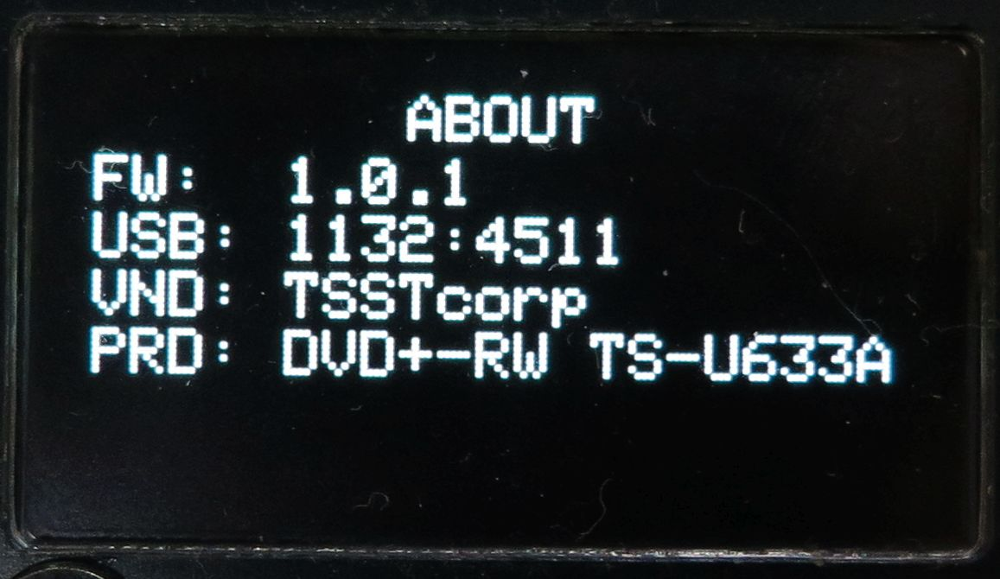
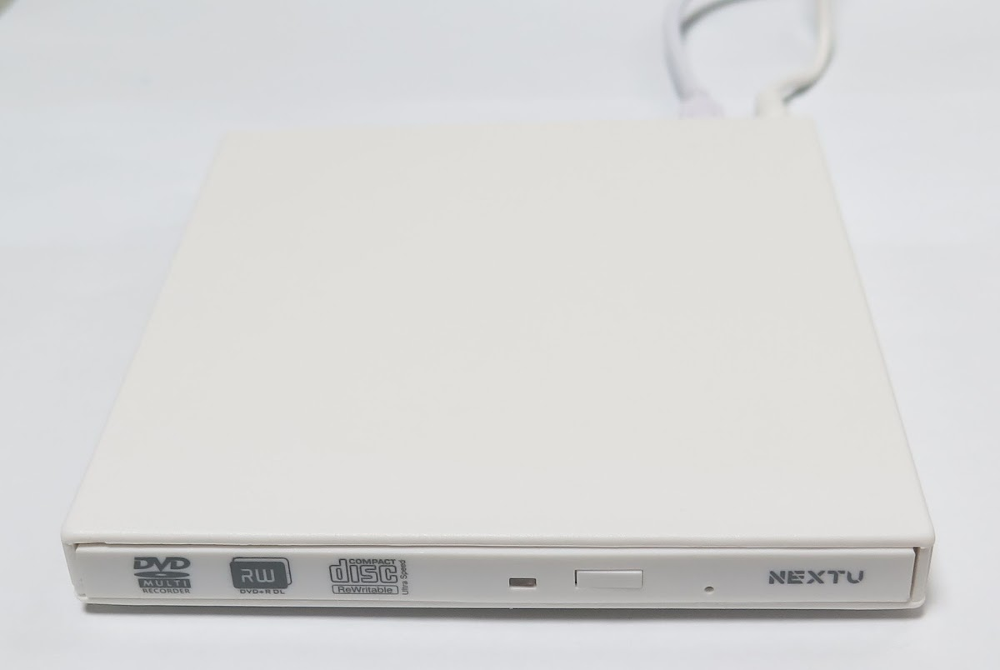
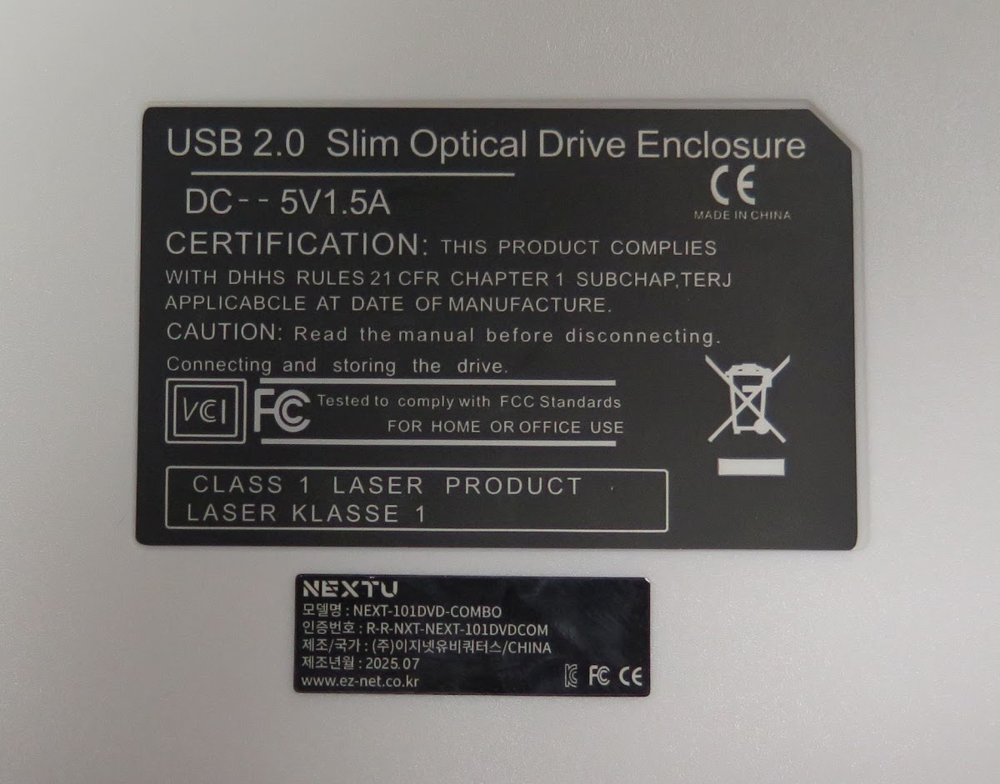

<!-- generated, do not edit -->
# OEM / USB 2.0 Slim Optical Drive Enclosure (NEXT-101DVD-COMBO): TSSTcorp DVD+-RW TS-U633A (r0013)

| Item | Value |
|---|---|
| Brand | OEM |
| Name on the drive | USB 2.0 Slim Optical Drive Enclosure (NEXT-101DVD-COMBO) |
| Vendor (VND) | TSSTcorp |
| Product (PRD) | DVD+-RW TS-U633A |
| USB ID | 1132:4511 |
| Drive type | Slim external USB drive (ready-made or in an enclosure) |
| Power to the drive | Extra 5 V to the drive (Y cable or auxiliary input) |
| Power adapter of the player | USB PD 20 W + QC 18 W |
| Condition | New |
| Result | 🟡 With workaround |
| Symptoms | None |
| Discs tried | Pressed audio CD |
| CONFIG > DRIVE > READ SPEED | 8x |
| CONFIG > DRIVE > WARMUP SECTORS | 300 |
| CONFIG > DRIVE > OVERLAP READ | Off |
| Firmware (FW) | 1.0.1 |
| Reported by | Elehobica |
| Date | 2026-11-08 |

## Comment

The power consumption is high. External 5V must be connected in prior to the USB connection to CD Drive Player.

## Photos

[Back to the drive report list](../../README.md)
